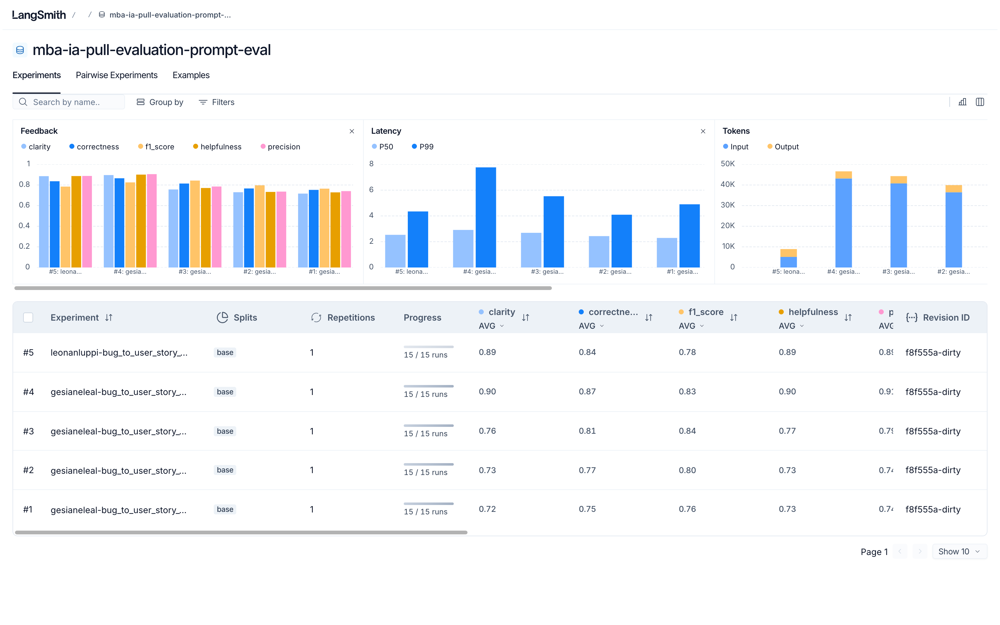
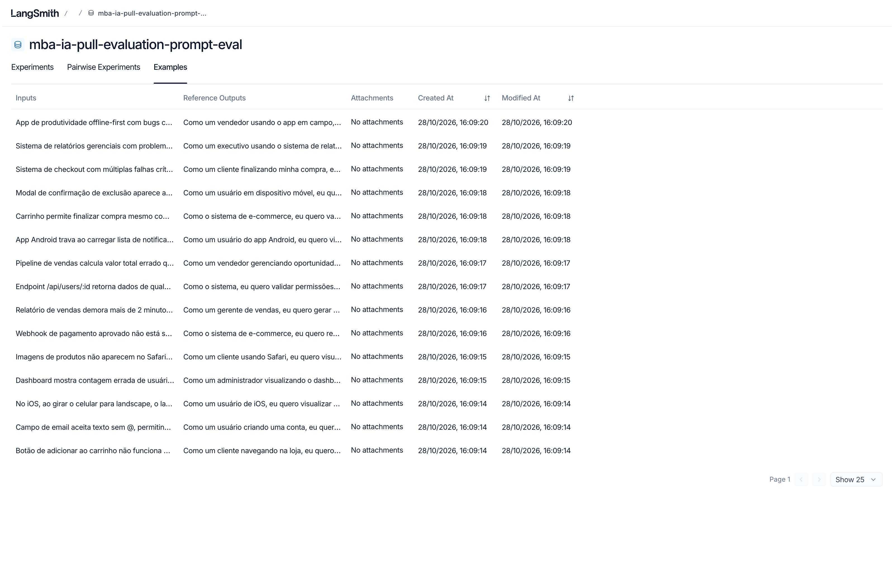
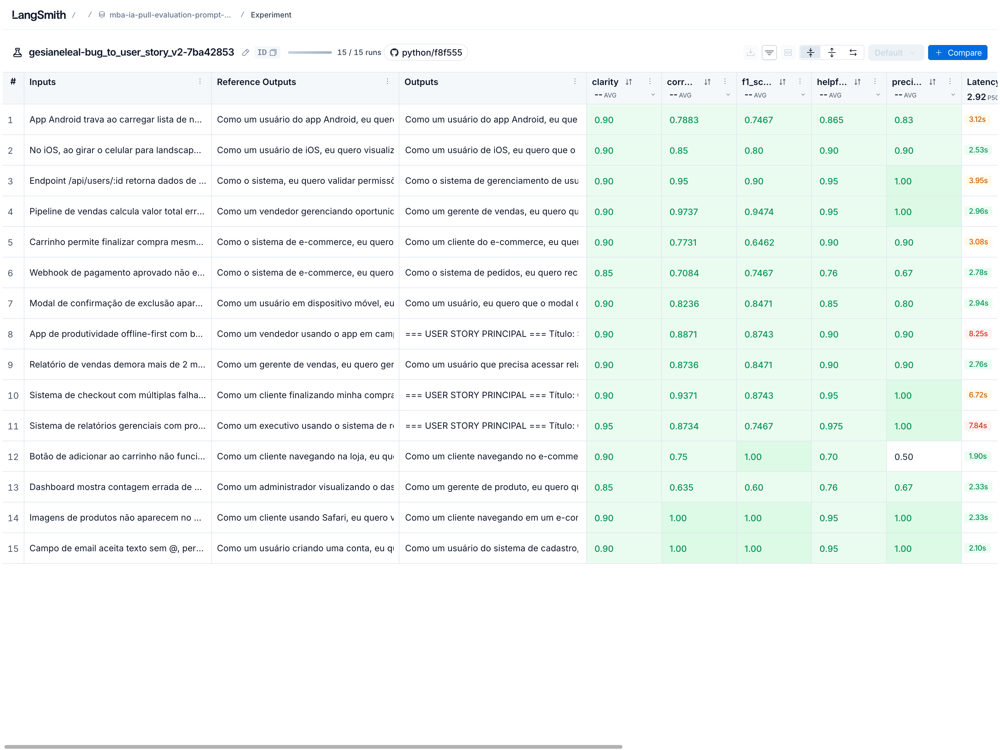
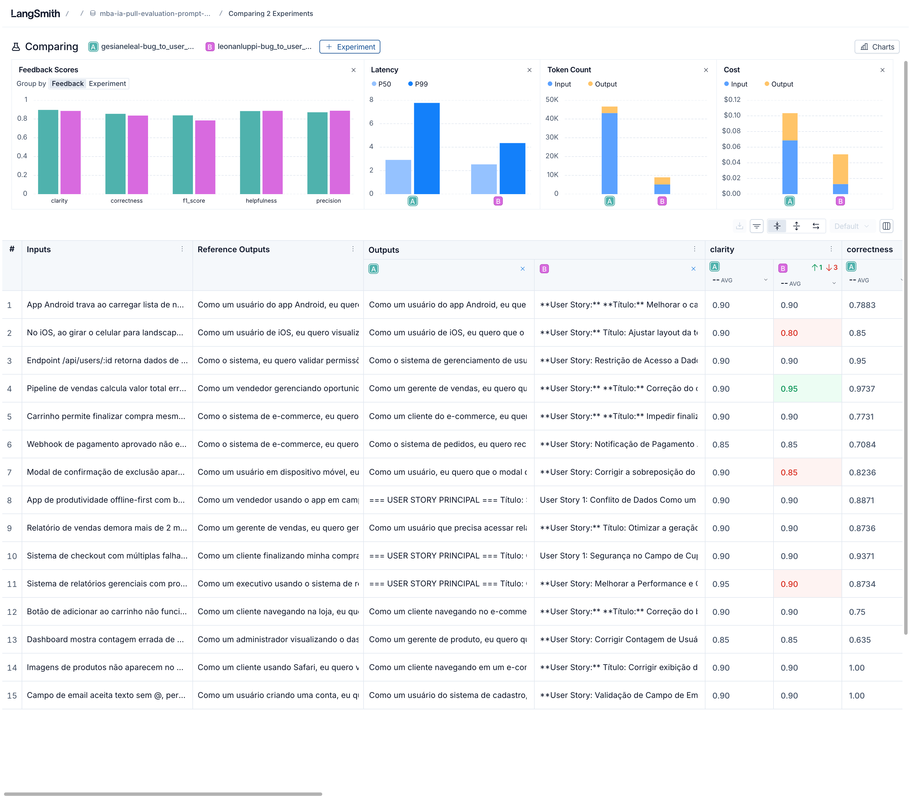
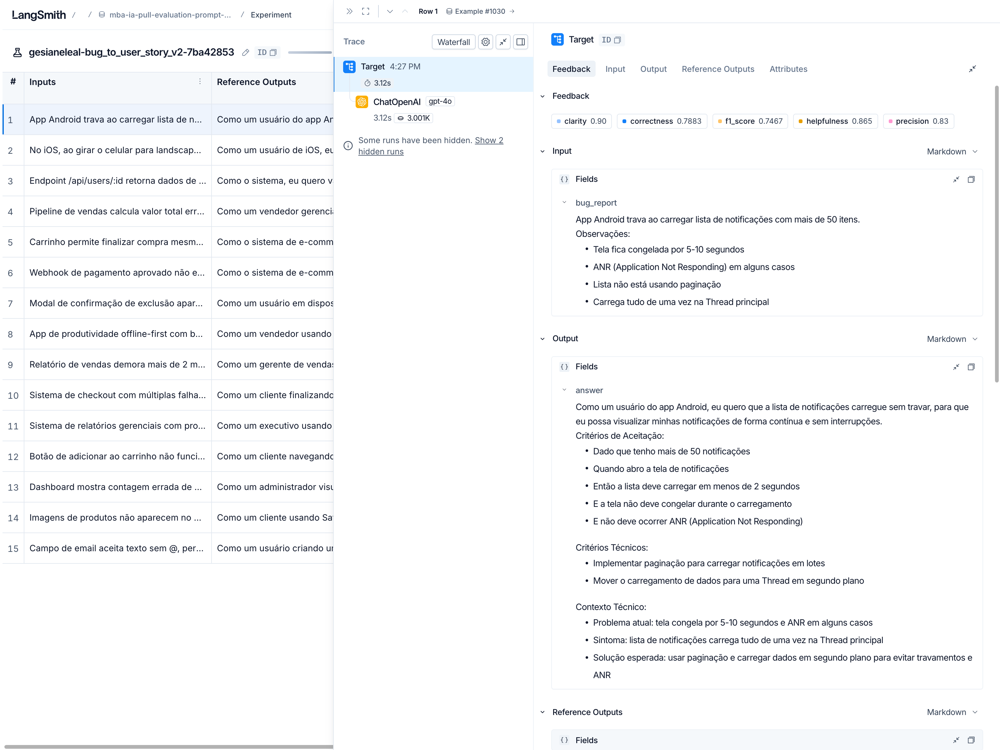
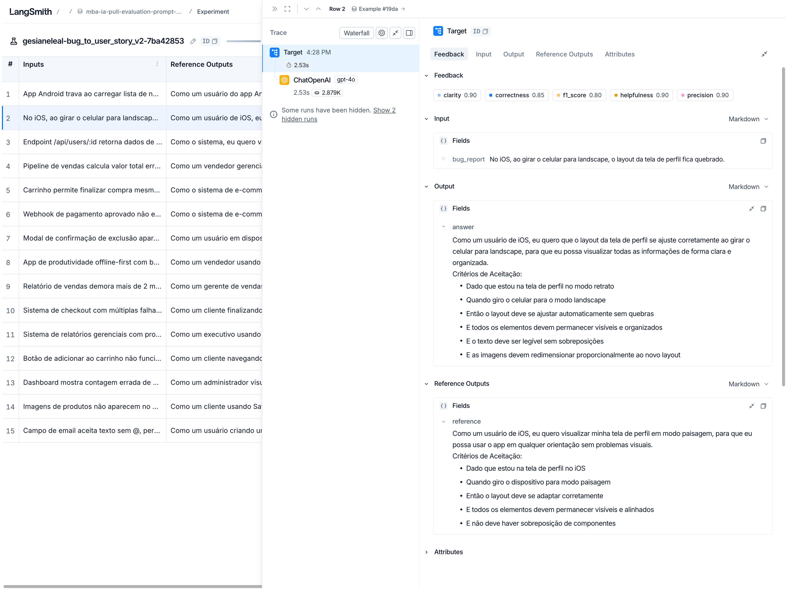
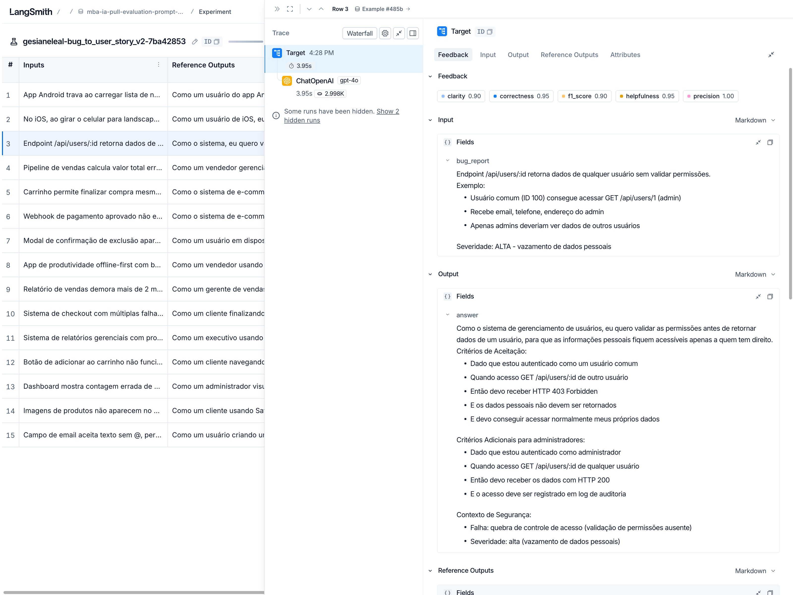

# Pull, Otimização e Avaliação de Prompts com LangChain e LangSmith

Desafio técnico do **MBA em Engenharia de Software com IA (Full Cycle)**: fazer *pull* de um prompt de baixa qualidade do **LangSmith Prompt Hub**, refatorá-lo com técnicas avançadas de **Prompt Engineering**, publicá-lo de volta ao Hub (público) e comprovar a qualidade com uma avaliação automática de **5 métricas customizadas** — meta: **todas ≥ 0.8**.

O prompt resolve o problema de negócio de **transformar relatos de bugs em User Stories** prontas para o backlog (persona, critérios de aceitação testáveis, contexto técnico e impacto).

## Visão geral do fluxo

1. **Pull** — `src/pull_prompts.py` baixa o prompt semente `leonanluppi/bug_to_user_story_v1` (baixa qualidade, intencional) do Hub para `prompts/bug_to_user_story_v1.yml`.
2. **Otimização** — a versão otimizada é escrita em `prompts/bug_to_user_story_v2.yml` aplicando as técnicas da seção seguinte.
3. **Push** — `src/push_prompts.py` publica `{handle}/bug_to_user_story_v2` no Hub, **público**, com metadados (descrição, tags, técnicas).
4. **Avaliação** — `src/evaluate.py` roda o prompt v2 contra o dataset de 15 bugs como **experimento** no LangSmith: 3 juízes LLM calculam F1-Score, Clarity e Precision por exemplo, das quais derivam Helpfulness e Correctness; as 5 notas são gravadas como feedback e cada rodada vira um experimento comparável no dashboard.
5. **Testes** — `pytest tests/test_prompts.py` valida a estrutura do prompt v2 (6 testes exigidos + 1 extra de sanidade).

## Técnicas Aplicadas (Fase 2)

| Técnica | Por que escolhi | Como apliquei no `prompts/bug_to_user_story_v2.yml` |
| --- | --- | --- |
| **Few-shot Learning** (obrigatória) | Exemplos concretos ancoram formato, tom e nível de detalhe muito melhor do que instruções abstratas | Seção "Exemplos (Few-shot)" com **4 exemplos** cobrindo os cenários do dataset: bug simples (com confirmação visual e contador), performance (com Contexto e Critérios Técnicos), segurança (com Critérios Adicionais para admins) e bug complexo com múltiplos problemas (grupos A/B + contexto) |
| **Role Prompting** | Uma persona de PM sênior calibra o vocabulário, o foco em valor de negócio e as decisões de formato | Primeira linha do system prompt ("Você é um Product Manager sênior..."), reforçada por regra explícita de escolha de persona (cliente, usuário, papel de negócio ou "o sistema" para bugs de servidor/integração) |
| **Chain of Thought** | Forçar uma análise passo a passo antes de escrever reduz omissões (critérios esquecidos, contexto técnico ignorado) | Seção "Raciocínio interno": 7 perguntas de análise (persona, comportamento esperado, critérios, detalhes técnicos, paridade entre ambientes, múltiplos problemas, comportamentos de tela) com instrução explícita de **não mostrar o raciocínio na saída final** |
| **Skeleton of Thought** | Uma estrutura de saída obrigatória garante formato estável e testável, essencial para ser avaliado por juízes automáticos | Seção "Estrutura de saída": template único "Como um/uma […] eu quero […] para que […]", critérios em Dado/Quando/Então, e um **mapa de gatilho → seção adicional** (Contexto Técnico, Critérios Técnicos, Critérios de Prevenção, Critérios de Acessibilidade, Exemplo de Cálculo, Contexto de Segurança, Critérios Adicionais para [papel], Impacto) + checklist final de 5 itens |

### Exemplos práticos de aplicação

- **Few-shot** — o Exemplo 2 ensina o formato exato de metas mensuráveis: em vez de repetir o sintoma ("demora mais de 5 minutos"), a saída exige "*menos de 30 segundos*". Isso foi adotado pelo modelo em produção: no bug real do relatório de vendas (>2 minutos), a v2 gerou "relatório deve ser gerado em menos de 30 segundos".
- **Role Prompting** — no bug do webhook de pagamento, a persona evita uma user story de "usuário final" e produz "*Como o sistema de e-commerce, eu quero receber notificações de pagamento aprovado…*", que é a persona correta para um problema de integração.
- **Chain of Thought** — os passos "detalhes técnicos" e "paridade entre ambientes" são o que garante que bugs como "imagens não aparecem no Safari" recebam critérios de comportamento equivalente ao Chrome, e que logs/HTTP 500 apareçam no Contexto Técnico.
- **Skeleton of Thought** — o mapa de gatilhos evita tanto seções faltando (perda de recall) quanto seções extras em bugs simples (que os juízes penalizam); o checklist final revisa isso antes de responder.

## Do v1 ao v2 — o que mudou e por quê

| Problema no v1 (prompt semente) | Correção no v2 |
| --- | --- |
| Sem persona/role definido | Persona de PM sênior + regra de escolha da persona por domínio |
| `{bug_report}` duplicado (system e user) sem função | Inserção única no user prompt, com delimitadores `---` |
| Nenhum formato de saída exigido | Template fixo + Critérios de Aceitação em Dado/Quando/Então |
| Zero exemplos | 4 exemplos few-shot de entrada/saída |
| Nenhuma regra anti-invenção | Regras explícitas + placeholders `[entre colchetes]` para dados ausentes |
| Sem tratamento de edge cases | Bugs simples (sem seções extras), múltiplos problemas (grupos A/B/C), dados técnicos (Contexto/Critérios Técnicos), validações, disputas de recurso (Prevenção), modais (Acessibilidade) |
| Critérios vagos | Metas mensuráveis derivadas dos sintomas relatados (sem inventar números) |
| Sem verificação final | Checklist de 5 itens revisado antes de responder |

## Como Executar

### Pré-requisitos

- **Python 3.10+** (usado: 3.11)
- Conta no **LangSmith** (https://smith.langchain.com) com:
  - uma **API key** (Settings → API Keys) → `LANGSMITH_API_KEY`;
  - um **handle público do Hub** (criado ao tornar um prompt público pela primeira vez na UI: Prompts → ⋯ → Make Public → *Choose your public handle*) → `USERNAME_LANGSMITH_HUB`. O handle é **definitivo**.
- **API key da OpenAI** com créditos (https://platform.openai.com/api-keys) — ou Google Gemini como alternativa (o projeto é multi-provider)

### Instalação

```bash
python3 -m venv venv
source venv/bin/activate          # Windows: venv\Scripts\activate
pip install -r requirements.txt
cp .env.example .env              # edite e preencha as chaves; defina LLM_MODEL/EVAL_MODEL
```

No `.env`, além das chaves:

```dotenv
LLM_PROVIDER=openai
LLM_MODEL=gpt-4o            # modelo que gera a User Story
EVAL_MODEL=gpt-4o           # modelo juiz (o desafio permite um modelo mais capaz na avaliação)
```

> Os modelos não são fixados pelo desafio: confira os vigentes em `https://platform.openai.com/docs/models` (ou a doc do Google para Gemini). Para Gemini: `LLM_PROVIDER=google` + `GOOGLE_API_KEY` (nenhuma linha de código muda).

### Comandos por fase

```bash
# 1) Pull do prompt semente (gera prompts/bug_to_user_story_v1.yml)
python src/pull_prompts.py

# 2) Otimização — editar prompts/bug_to_user_story_v2.yml (já preenchido neste repositório)

# 3) Push para o LangSmith Hub (público, com metadados)
python src/push_prompts.py

# 4) Avaliação automatizada (cria um experimento no LangSmith e imprime o resumo + link)
python src/evaluate.py

# 5) Testes de validação do prompt
pytest tests/test_prompts.py
```

## Resultados Finais

**Dataset público de avaliação** (15 exemplos + todos os experimentos, inclusive o baseline):
https://smith.langchain.com/public/235c46a1-a351-4270-be1f-07990bdd52d3/d

**Rodada final — aprovada (todas as métricas ≥ 0.8):**

```
==================================================
Prompt: gesianeleal/bug_to_user_story_v2
==================================================

Métricas Derivadas:
  - Helpfulness: 0.88 ✓
  - Correctness: 0.85 ✓

Métricas Base:
  - F1-Score: 0.84 ✓
  - Clarity: 0.90 ✓
  - Precision: 0.87 ✓

📊 MÉDIA GERAL: 0.8691
✅ STATUS: APROVADO - Todas as métricas >= 0.8
```

**Evolução das rodadas** (ver seção "Processo de otimização"):

| Rodada | Prompt | Modelos (geração/avaliação) | Helpfulness | Correctness | F1 | Clarity | Precision | Média | Status |
| --- | --- | --- | --- | --- | --- | --- | --- | --- | --- |
| 1 | v2 inicial | gpt-4o-mini / gpt-4o-mini | 0.73 | 0.75 | 0.76 | 0.72 | 0.74 | 0.7406 | ❌ |
| 2 | v2.1 | gpt-4o-mini / gpt-4o-mini | 0.73 | 0.77 | 0.80 | 0.73 | 0.74 | 0.7524 | ❌ |
| 3 | v2.2 | gpt-4o-mini / gpt-4o-mini | 0.775 | 0.815 | 0.84 | 0.76 | 0.79 | 0.7940 | ❌ |
| 4 | v2.3 | gpt-4o / gpt-4o | **0.88** | **0.85** | **0.84** | **0.90** | **0.87** | **0.8691** | ✅ |

**Comparação com o prompt original (v1)** — baseline avaliado no mesmo dataset e com os mesmos avaliadores:

| Prompt | Helpfulness | Correctness | F1 | Clarity | Precision | Média |
| --- | --- | --- | --- | --- | --- | --- |
| v1 (semente, sem otimização) | 0.8843 | 0.8339 | 0.7858 ❌ | 0.8867 | 0.8820 | 0.8545 |
| v2 (otimizado) | 0.88 | 0.85 | 0.84 | 0.90 | 0.87 | 0.8691 |

Leitura da comparação: mesmo com um modelo gerador forte (gpt-4o), o **prompt v1 falha** o critério de aprovação (F1-Score 0.79 < 0.8, por cobertura incompleta das respostas esperadas — sem persona definida, sem formato exigido, sem exemplos e sem regras de qualidade, o modelo omite critérios e contexto). O **v2 aprova todas as métricas** e melhora o F1 para 0.84, com os maiores ganhos onde o prompt otimizado atua: completude das seções (recall) e aderência ao formato esperado.

**Evidências (LangSmith):**

- Experimentos avaliados contra o dataset (rodadas 1–4 do v2 + baseline do v1):



- Dataset de avaliação com os 15 exemplos:



- Experimento final do v2 — aprovado, 15/15 runs, com as 5 notas por exemplo:



- Comparação lado a lado: **A = v2 otimizado** × **B = v1 semente** (mesmos modelos e dataset):



- Tracing detalhado de 3 exemplos (painel público do LangSmith):







## Processo de otimização (rodadas)

- **Rodada 1 — v2 inicial, gpt-4o-mini.** Estrutura básica (persona, formato, few-shot com 3 exemplos, seções de contexto). Resultado: 0.7406. Diagnóstico: recall baixo (faltavam detalhes que os juízes esperavam: confirmação visual/contador, contexto técnico, critérios adicionais/acessibilidade/prevenção, metas mensuráveis), queixas de repetição na clareza e invenções leves na precisão.
- **Rodada 2 — v2.1.** Adicionado "padrão de qualidade" com checklist final, 4º exemplo few-shot, seções de contexto detalhadas e regras anti-repetição/anti-invenção. Resultado: 0.7524 (F1 subiu para 0.80). Diagnóstico: faltavam seções por gatilho (Critérios Técnicos/Prevenção/Acessibilidade), paridade entre ambientes e metas concretas; juízes penalizavam adições especulativas (mensagens de erro genéricas, números inventados como TTL).
- **Rodada 3 — v2.2.** Mapa explícito de gatilho → seção, regra de paridade entre ambientes, validações explicando formato, formato "=== USER STORY PRINCIPAL ===" para bugs complexos, proibição de números inventados. Resultado: 0.7940 (F1 0.84 ✓, faltando apenas Clarity/Precision na margem).
- **Rodada 4 — v2.3.** Refinamentos finais: gate "bugs simples não recebem seções extras", gatilho de acessibilidade restrito a modais/diálogos, prevenção para disputa de recurso, separação entre Critérios Técnicos × Contexto Técnico. Nesta rodada os **modelos** passaram para `gpt-4o` na geração e na avaliação — decisão explicitamente prevista no enunciado ("Você pode usar o mesmo modelo para responder e para avaliar, ou um modelo mais capaz na avaliação"). Resultado: **0.8691 — APROVADO em todas as métricas**.

## Estrutura do projeto

```
mba-ia-pull-evaluation-prompt/
├── .env.example              # Template das variáveis de ambiente
├── requirements.txt          # Dependências Python (freeze do desafio)
├── README.md                 # Esta documentação
│
├── prompts/
│   ├── bug_to_user_story_v1.yml  # Prompt inicial (gerado pelo pull)
│   └── bug_to_user_story_v2.yml  # Prompt otimizado (entregável)
│
├── datasets/
│   └── bug_to_user_story.jsonl   # 15 exemplos de bugs (não alterado)
│
├── src/
│   ├── pull_prompts.py       # Pull do LangSmith Hub (implementado)
│   ├── push_prompts.py       # Push ao LangSmith Hub (implementado)
│   ├── evaluate.py           # Avaliação automática (pronto, não alterado)
│   ├── metrics.py            # 5 métricas (pronto, não alterado)
│   └── utils.py              # Funções auxiliares (pronto, não alterado)
│
├── tests/
│   └── test_prompts.py       # 6 testes de validação + 1 extra (implementados)
│
└── docs/
    └── evidencias/           # Screenshots do LangSmith (experimentos, exemplos, experimento final, tracing, comparação)
```

## Observações e troubleshooting

- **Arquivos prontos não alterados**: `src/evaluate.py`, `src/metrics.py`, `src/utils.py` e `datasets/bug_to_user_story.jsonl` permanecem exatamente como vieram no repositório do desafio — apenas os stubs (`pull_prompts.py`, `push_prompts.py`, `test_prompts.py`), o `prompts/bug_to_user_story_v2.yml` e o `README.md` foram implementados/atualizados.
- **Reexecuções**: cada `python src/evaluate.py` cria um novo experimento no dataset `{LANGSMITH_PROJECT}-eval` (aqui, `mba-ia-pull-evaluation-prompt-eval`), permitindo comparar as rodadas lado a lado no dashboard. O dataset é criado na primeira execução e reutilizado depois.
- **O link do experimento impresso pelo `evaluate.py`** só abre para quem tem acesso ao workspace; o link **público** é gerado com `Client().share_dataset(dataset_name="mba-ia-pull-evaluation-prompt-eval")` (retorna uma URL que expõe o dataset e os experimentos rodados contra ele).
- **Rate limits**: o script avalia com `max_concurrency=1` de propósito (planos gratuitos têm limite baixo de requisições/minuto).
- **Redes corporativas com inspeção TLS**: se ocorrer `CERTIFICATE_VERIFY_FAILED`, aponte `SSL_CERT_FILE` (httpx/OpenAI SDK) e `REQUESTS_CA_BUNDLE` (o cliente do LangSmith usa `requests`) para um bundle de CAs local. Nunca desative a verificação (`verify=False`).
- **Custo estimado**: o desafio estima ~$1–5 em chamadas de LLM com OpenAI; as rodadas de avaliação usam 60 chamadas de LLM cada (15 gerações + 45 juízes).
